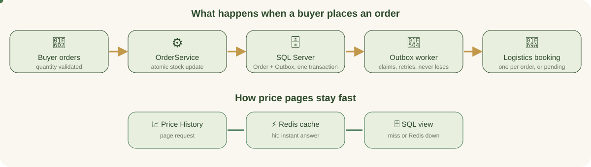
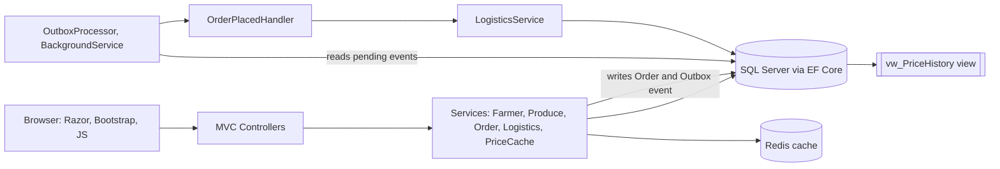
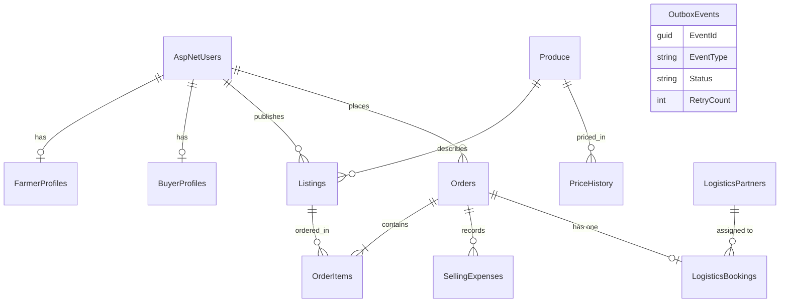
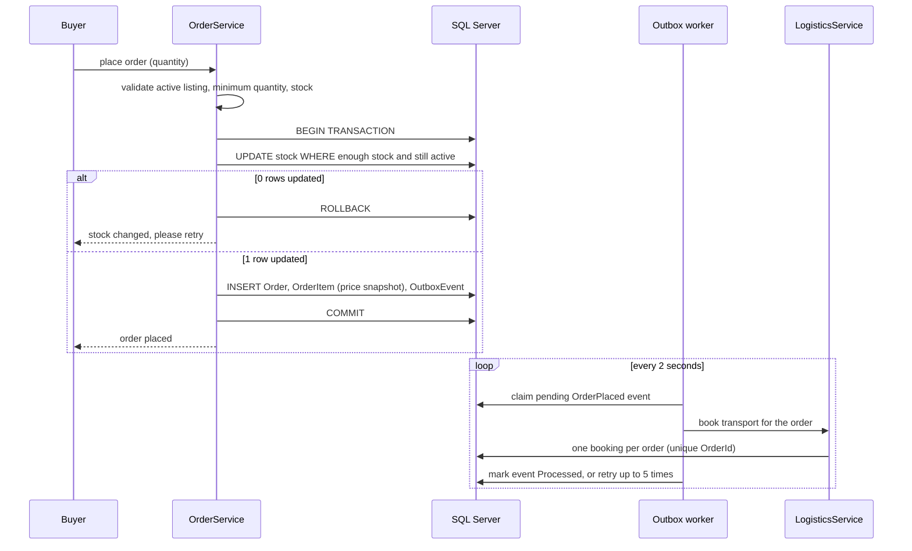
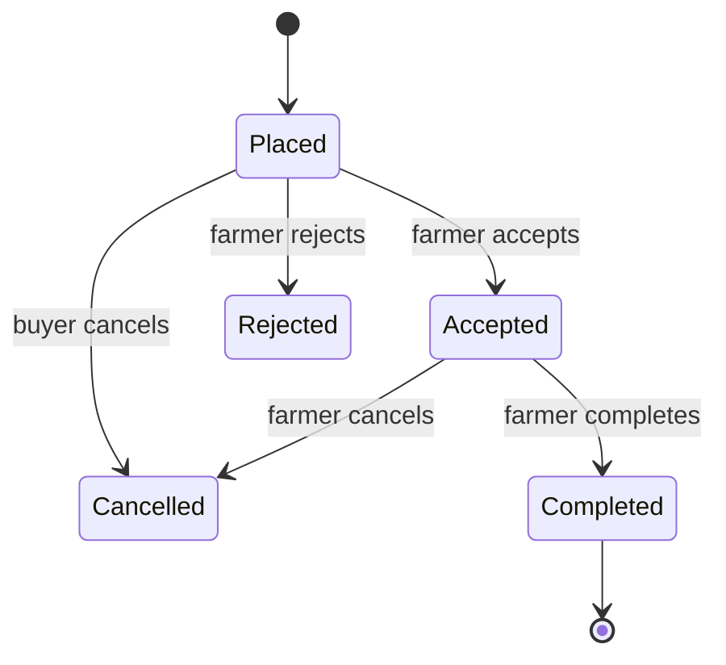
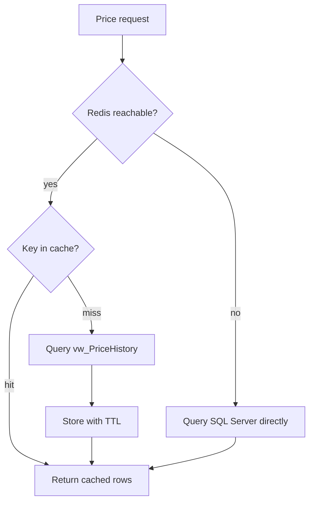

<div align="center">



[](https://git.io/typing-svg)


</div>

---

## 🌱 What is FarmConnect?

A farmer-to-buyer agricultural marketplace built as a **modular monolith** (one ASP.NET Core app, cleanly separated services).
**Farmers** publish produce and track earnings, **Buyers** search and order, **Admins** monitor orders, transport and system health.



## ✅ What is inside

### Milestone 1: the marketplace

| # | Module | Status |
|---|--------|:------:|
| 1 | Registration, login, **Farmer / Buyer / Admin** roles (ASP.NET Core Identity) | ✅ |
| 2 | Farmer produce management: add, edit, deactivate, history-safe remove, image upload | ✅ |
| 3 | Buyer marketplace: search, grade / price / location filters, sorting, quantity picker | ✅ |
| 4 | Order placement: minimum quantity and stock validation, **atomic transaction**, stock reserve and release | ✅ |
| 5 | **Price history from a SQL view** `vw_PriceHistory` with interactive Chart.js charts | ✅ |
| 6 | Farmer earnings: daily, weekly, monthly or custom range, gross, costs, net proceeds | ✅ |

### Milestone 2: services, events and caching

| # | Module | Status |
|---|--------|:------:|
| 1 | **FarmerService, ProduceService, OrderService** (plus LogisticsService and PriceCacheService) behind interfaces and dependency injection | ✅ |
| 2 | **`OrderPlaced` event books logistics**: transactional **outbox**, background worker, idempotent handler, retries | ✅ |
| 3 | **Redis caches market prices**: cache-aside, TTLs, versioned invalidation, automatic **SQL fallback** | ✅ |

## 🧭 Architecture





## 🔒 Order flow: concurrency-safe, with an outbox





**Stock rules:** reserved when an order is *Placed*, released if it is *Rejected* or *Cancelled*, counted as *sold* when *Completed*. A database `CHECK` constraint prevents negative stock, and `AgreedUnitPrice` is stored per order item so old revenue never changes when prices change.

## 🚚 Logistics booking (M2)

- After an order is saved, an `OrderPlaced` event sits in the **outbox table in the same transaction**, so a crash cannot lose it.
- A background worker processes events. A **unique `OrderId`** on bookings means processing an event twice still creates **one** booking.
- A partner is chosen if it is **active and available**, covers the **pickup and delivery** areas, has enough **capacity**, and has the lowest rate. Units kg, quintal and ton convert to kg.
- If nobody fits, the booking becomes **PendingAssignment**. Admin can assign manually or press **Re-match**. A rejected or cancelled order cancels its booking.
- Partners are **demo records**, costs are **estimates**, and no real vehicle is dispatched.

## ⚡ Redis price cache (M2)



- Keys look like `farmconnect:prices:{produceId}:{market}:{from}:{to}:v{version}`. TTLs: today **30 min**, history **60 min**, static lists **6 h** (configurable).
- Adding a price bumps a **version number**, so stale keys are never read again. Admins can also flush the cache.
- If Redis fails, the app logs it, uses SQL Server, and skips Redis for 30 seconds. Redis never blocks the marketplace.
- Only public price data is cached. **Stock is never cached**; order placement always checks SQL Server.

## 🛡️ Security and data protection

| Area | What FarmConnect does |
|------|-----------------------|
| **Passwords** | ASP.NET Core Identity **salted PBKDF2 hashes**, never stored or logged in plain text. Minimum 8 characters with upper, lower, digit, symbol and 4 distinct characters. |
| **Brute force** | Account **lockout** after 5 failed logins (15 minutes) and a **rate limit** of 12 login or register requests per minute per IP. |
| **Sessions** | `HttpOnly`, `SameSite=Lax` cookies, 8-hour sliding expiry, `Secure` over HTTPS. Locking a user **signs them out within about a minute**. |
| **CSRF** | Anti-forgery token on every POST, with a `SameSite=Strict` anti-forgery cookie. |
| **XSS and injection** | Razor output encoding, HTML-escaped JSON in pages, a **Content-Security-Policy**, and EF Core parameterised queries (the only raw SQL is fixed DDL). |
| **Headers** | `X-Content-Type-Options`, `X-Frame-Options: DENY`, `Referrer-Policy`, `Permissions-Policy`, HSTS in production, and `Cache-Control: no-store` for signed-in pages. |
| **Authorization** | Role checks plus **ownership checks**: farmers touch only their listings, buyers see only their orders, and admin pages are Admin-only. Prices and quantities are never trusted from the browser. |
| **Privacy** | Login and register never reveal whether an email exists. No card, ID or payment data is collected. |
| **Uploads** | Type, size and **file-signature** checks, random file names, `nosniff`. |
| **Secrets** | Connection string and admin password go in **user-secrets or environment variables**. Outside Development the app refuses to create an admin without your own password, and **demo accounts exist only in Development**. |

**Known limits (honest list):** no email verification or MFA yet, no payment gateway, run behind HTTPS in production, and keep database backups and key storage per your host.

## 🚀 Quick start on Windows

```powershell
# 1) tools: .NET 8 SDK, VS Code, Docker Desktop
winget install Microsoft.DotNet.SDK.8

# 2) SQL Server and Redis in Docker
docker run -e "ACCEPT_EULA=Y" -e "MSSQL_SA_PASSWORD=FarmConnect#2026" -p 1433:1433 --name farmconnect-sql -d mcr.microsoft.com/mssql/server:2022-latest
docker run -d --name farmconnect-redis -p 6379:6379 redis:7

# 3) keep secrets out of the project (recommended)
cd FarmConnect
dotnet user-secrets init
dotnet user-secrets set "Seed:AdminPassword" "ChooseAStrongAdminPassword!9"

# 4) run
$env:ASPNETCORE_ENVIRONMENT="Development"
dotnet run --urls "http://localhost:5000"
```

The first start creates the database, roles, the price-history view, the M2 tables and sample data. Change `ConnectionStrings:Default` or `Redis:Configuration` for other servers.

### 🔑 Development demo accounts (Development only)

| Role | Email | Password |
|------|-------|----------|
| 🛡️ Admin | `admin@farmconnect.com` | the value you set in `Seed:AdminPassword`, or `Admin@12345` if unset |
| 🧑‍🌾 Farmer | `farmer@demo.com` | `Demo@12345` |
| 🛒 Buyer | `buyer@demo.com` | `Demo@12345` |

## ✨ UI highlights

- 🌄 **Living farm scene**: moving sun, clouds, birds, parallax hills, a tractor, a live listing carousel, and light and dark themes
- 🧭 Animated header and footer, scroll progress bar, back-to-top, and an interactive FAQ with search
- 📊 **Dashboards**: animated KPI cards, gauges, charts, action inbox, stock bars, and order timelines
- 💹 **Price History and Earnings**: switchable charts, waterfall, heat strip, profit margin and money-flow views
- 🛡️ **Admin control room**: auto-refreshing numbers, live order feed, alerts and health gauges
- 🚚 **Logistics**: animated route map, filterable booking cards, partner switches and the event pipeline
- 📝 **Register wizard**: role cards, live validity ticks, password generator and checklist, and a review card

## 📁 Structure

```
FarmConnect/
├─ Controllers/   Account · Dashboard · Listings · Market · Orders · Price · Earnings · Admin · Logistics
├─ Services/      Contracts · CoreServices (Farmer, Produce, Order) · LogisticsAndCache (Logistics, Outbox, Redis)
├─ Models/        Entities.cs · ViewModels.cs
├─ Data/          ApplicationDbContext · DbSeeder
├─ Views/         Razor pages and partials
├─ wwwroot/       css · js · uploads
├─ docs/          banner.svg · flow.svg
└─ Database/      vw_PriceHistory.sql
```

## 🧪 Test checklist

**M1**
- [ ] Farmer lists 500 kg, minimum 50 kg at ₹25/kg
- [ ] Buyer orders 20 kg is rejected, 600 kg is rejected, 100 kg succeeds and stock becomes 400 kg
- [ ] Farmer accepts and completes, and the sale appears in Earnings
- [ ] Rejecting or cancelling restores stock
- [ ] Another farmer cannot open `/Listings/Edit/{id}` of this listing (404)

**M2**
- [ ] A new order creates an `OrderPlaced` event that becomes **Processed**, and a booking appears
- [ ] A route no partner covers shows **PendingAssignment**, and **Re-match** or manual assignment fixes it
- [ ] Cancelling the order cancels its booking
- [ ] Price History: first load is a cache **miss**, the refresh is a **hit**, and adding a price invalidates it
- [ ] `docker stop farmconnect-redis` still serves prices from SQL Server

**Security**
- [ ] More than 12 rapid login attempts returns **429**
- [ ] A locked user is signed out within about a minute
- [ ] Renaming a `.txt` file to `.jpg` and uploading it is rejected
- [ ] Registering an existing email gives a generic message
- [ ] After logout, the browser Back button does not show private pages

## 🗺️ Notes

- Price data is a **clearly labelled sample dataset**. Plug in AGMARKNET later, and never mix ₹/kg with ₹/quintal.
- *Net proceeds* = gross − recorded selling costs. It is **not** farm profit.

<div align="center">


<sub>Built with purpose. Delivered with care. 🌾</sub>

</div>