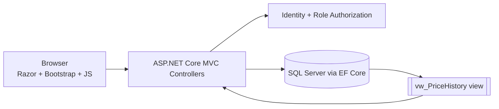
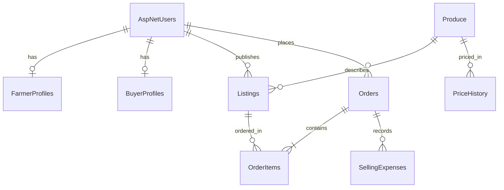
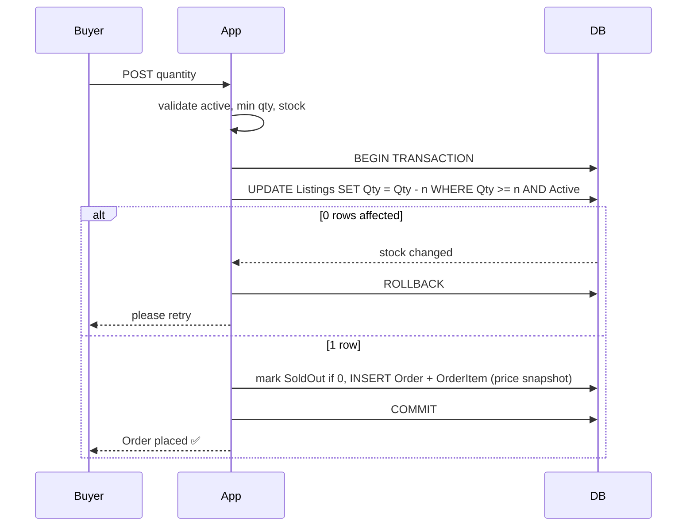

<div align="center">


[](https://git.io/typing-svg)


</div>

---

## 🌱 What is FarmConnect (M1)?

A farmer-to-buyer agricultural marketplace. **Farmers** publish produce and track earnings, **Buyers** search and order, **Admins** monitor everything.

| # | Module | Status |
|---|--------|:------:|
| 1 | Registration, login, **Farmer / Buyer / Admin** roles (ASP.NET Core Identity) | ✅ |
| 2 | Farmer produce management (add, edit, deactivate, remove-safe, image upload) | ✅ |
| 3 | Buyer marketplace: search, grade / price / location filters, sorting, detail page | ✅ |
| 4 | Order placement: min-qty + stock validation, **atomic transaction**, stock reserve/release | ✅ |
| 5 | **Price history from SQL view** `vw_PriceHistory` + Chart.js graph | ✅ |
| 6 | Farmer earnings: daily / weekly / monthly / custom, gross, costs, net proceeds | ✅ |

## 🚀 Quick start

```bash
# prerequisites: .NET 8 SDK + SQL Server (LocalDB / Express / Docker)
cd FarmConnect
dotnet restore
dotnet run
```

Open the URL printed in the console. On first start the app **creates the database, roles, the price-history SQL view and demo data automatically.**

**Different SQL Server?** Edit `ConnectionStrings:Default` in `appsettings.json`.
Docker example:

```bash
docker run -e ACCEPT_EULA=Y -e MSSQL_SA_PASSWORD='Your_strong_pass1' -p 1433:1433 -d mcr.microsoft.com/mssql/server:2022-latest
# Server=localhost,1433;Database=FarmConnectDb;User Id=sa;Password=Your_strong_pass1;TrustServerCertificate=True
```

**Want real EF migrations?** (the app uses them automatically if they exist)

```bash
dotnet tool install --global dotnet-ef
dotnet ef migrations add InitialCreate
dotnet ef database update
```

## 🔑 Demo accounts

| Role | Email | Password |
|------|-------|----------|
| 🛡️ Admin | `admin@farmconnect.com` | `Admin@12345` |
| 🧑‍🌾 Farmer | `farmer@demo.com` | `Demo@12345` |
| 🛒 Buyer | `buyer@demo.com` | `Demo@12345` |

> Change the admin credentials in `appsettings.json → Seed` before any real deployment.

## 🧭 Architecture





## 🔒 Order flow (concurrency-safe)



**Stock rules:** reserved when an order is *Placed* → released if *Rejected/Cancelled* → counted as *sold* when *Completed*. A DB `CHECK` constraint prevents negative stock. `AgreedUnitPrice` is stored per order item, so old revenue never changes when prices change.

## 🛡️ Security highlights

- Identity password hashing, lockout after 5 failed logins, anti-forgery tokens on every POST
- Role-based `[Authorize]`; Admin can **never** be chosen at registration (seeded only)
- Ownership checks: farmers edit only their own listings; buyers see only their own orders
- Server-side validation for every rule (JS is only a convenience)
- Listings with orders are deactivated, never hard-deleted

## 📁 Structure

```
FarmConnect/
├─ Controllers/   Account · Dashboard · Listings · Market · Orders · Price · Earnings · Admin
├─ Models/        Entities.cs · ViewModels.cs
├─ Data/          ApplicationDbContext · DbSeeder (roles, SQL view, sample data)
├─ Views/         Razor pages (Greenaura-inspired UI)
├─ wwwroot/       css · js · uploads
└─ Database/      vw_PriceHistory.sql
```

## ✅ Manual test checklist

- [ ] Farmer lists **500 kg**, min **50 kg**, ₹25/kg tomatoes
- [ ] Buyer orders 20 kg → ❌ below minimum · 600 kg → ❌ insufficient stock
- [ ] Buyer orders 100 kg → ✅ stock becomes **400 kg**
- [ ] Farmer *Accepts → Marks completed* → appears in **Earnings** (₹2,500)
- [ ] Rejecting / cancelling a placed order **restores** stock
- [ ] Farmer B cannot open `/Listings/Edit/{id}` of Farmer A (404)
- [ ] Price History shows chart + table from the SQL view
- [ ] Admin can lock users and deactivate listings

## 🗺️ Notes

- Price data is a **clearly labelled sample dataset**; plug in AGMARKNET later. Never mix ₹/kg and ₹/quintal.
- *Net proceeds* = gross − recorded selling costs; it is **not** farm profit.
- Hero photo is loaded from Unsplash; swap it in `wwwroot/css/site.css` if you prefer a local image.

<div align="center"><sub>Built with purpose. Delivered with care. 🌾</sub></div>
